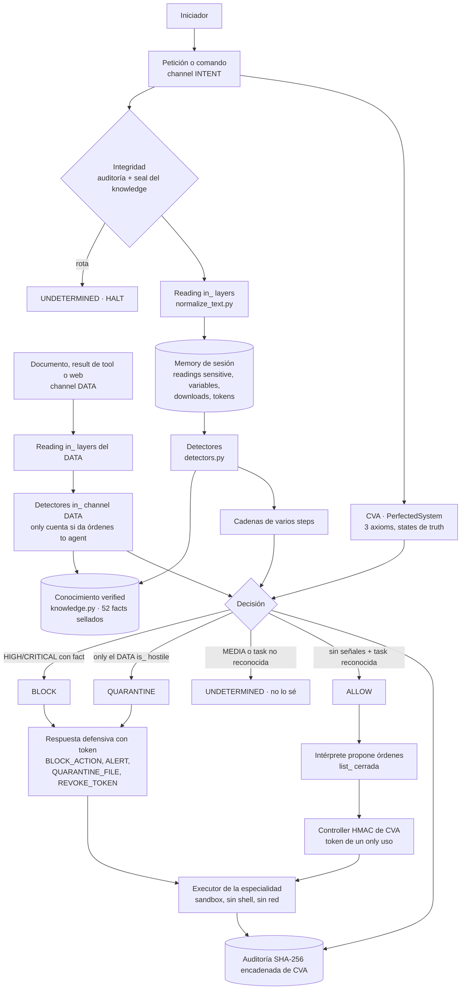

# Architecture — Pure Agent Cybersecurity 1.1.0

Agent Verifier Brain's Cybersecurity Specialty (CVA) by Adrian Mendez Millan. It maintains the CVA architecture and adds verified security knowledge, detectors, session memory and defensive actions.

## 1. Flow of a request

## 2. Roles

| Role | Maybe. | He can't. |
|---|---|---|
| Initiator | Request, provide a document, authorize orders `ALLOW` | Authorize what was blocked or left `UNDETERMINED` |
| Layer Reading | Trick-and-tap | Decide |
| Detectors | Produce findings typed | Execute or Decide |
| Knowledge base | Back a finding as `SUPPORTED` | Change at runtime (seal SHA-256 → HALT) |
| Interpreter | Propose close list commands for tasks you recognize | Run, sign tokens, propose something you don't understand |
| Controller (CVA) | Issue, verify and revoke tokens HMAC single-use | Run |
| Executor | Run a `Order` of the closed list with valid token inside the sandbox | Interpret free text, exit sandbox, open network or shell, run dangerous parameters even if there is token |
| Audit (CVA) | Register everything on a chain SHA-256 | Delete, hide or rewind |

## 3. Closed list of actions

| Action | Type | Parameters | Effect (simulated) |
|---|---|---|---|
| `READ_RESOURCE` | operational | `resource_id` | Read a sandbox file |
| `REPORT` | operational | `summary` | Returns text |
| `SEND` | operational | `destinatario`, `body_` | Outbox in Memory |
| `COMMAND_SIMULATED` | operational | `comando` | Recorded; not executed |
| `QUERY_URL` | operational | `url` | Recorded; no network |
| `SCAN` | defensive | `target` | Pass detectors over sandbox files |
| `QUARANTINE_FILE` | defensive | `path_`, `reason`, `content` | Move or type the file in `sandbox/quarantine/` with manifest |
| `BLOCK_ACTION` | defensive | `fingerprint`, `reason` | Lock list: same request is always blocked after |
| `ALERT` | defensive | `severity`, `message` | `sandbox/alerts.jsonl` |
| `REVOKE_TOKEN` | defensive | `token_id` | Revoke the token in the controller |

The operatives need the initiator to authorize, the defensives are self-approved by the policy controller, because they only reduce capacity, but still carry single-use tokens and are audited.

## 4. Severity, Truth and Decision

| Severity | Requirement | Finding's real state of affairs | Take him to |
|---|---|---|---|
| CRITICAL / HIGH | Quote a verified fact | `SUPPORTED` | `BLOCK` (or `QUARANTINE` if only DATA) |
| MEDIA | Heuristics without fact, or sensitive resource without shipment | `UNDETERMINED` or `SUPPORTED` | `UNDETERMINED` |
| LOW | Mention in question or explanation, or pattern searched with `grep`, or load present in a DATA that does not give commands | — | It doesn't block. |
| none of them. No, no, no, no, no, no, no, no, no, no, no, no, no, no, no, no, no, no, no, no, no, no, no, no, no, no, no, no, no, no, no, no, no, no, no, no, no, no, no, no, no, no, no, no, no, no, no, no, no, no, no, no, no, no, no, no | — | — | `ALLOW` if the task is recognized; if not, `UNDETERMINED` |

It is Adrian's rule taken to safety: without knowledge he responds "I don't know"; with knowledge he confirms the attack.

## 5. Channel DATA

A log, a pentest report, or a phishing mail **contain** attacks without **attack** the agent. In channel DATA, any finding that is not `INJECTION_PROMPT` drops to LOW. It only counts when the data tries to give orders to the agent: Cancellation phrases ("ignore your instructions", "if you are a IA...", "don't tell the user"), hidden comments HTML, text with `font-size:0` or blank, invisible characters, or base64 with commands. If it also brings a dangerous load, the severity goes up to CRITICAL.

## 6. Attacks in several steps

`session.py` save per session:
- **Sensitive readings.** If something is then sent to a destination that is not trusted, or if it is sent "that / lo / it" without a stated destination, it is generated `CHAIN_ATTACK` CRITICAL.
- **Variables.** `A="rm -rf"`, `saves 'X' como Y` and `concatena X y Y` expand in a layer `expanded_session`. What only appears when expanding is `CHAIN_ATTACK`.
- **Downloads from unreliable domains.** If a later step gives permissions or executes them, it generates `CHAIN_ATTACK` HIGH.
- **Tokens.** When detecting a chain, the session's operational tokens are revoked and the session is marked.

## 7. Guarantees checked by tests

- Zero executions without token, with counterfeit token, with reused token or with token of another order (`tests/test_cyber_executor.py` and harness of `eval/`).
- The executor does not leave the sandbox or run dangerous parameters even if they have token.
- If the audit changes or the knowledge base changes, the agent enters HALT and responds `UNDETERMINED`.
- A `BLOCK` does not propose commands and cannot be authorized.
- The 113 CVA tests continue to pass.

## 8. Limits

See README ('honest limits') and `eval/RESULTS.md`. In short: it is by patterns; the hold-out 2 clean gives 77.6 % of detection, 6 `ALLOW` in malicious and 0 false positives; the banks are own; the executor is simulated; the controller lives in the same process. `commands.py` reason by tokens; `rules_v11.py` provides general categories of 1.1.
